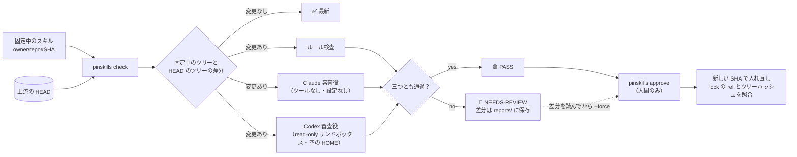

<div align="center">

# 📌 pinskills

**エージェント用スキルをコミット SHA に固定する。隔離した二つの LLM 審査役とルール検査がそろって安全と判断するまで、中身は変わらない。**

[](https://www.npmjs.com/package/pinskills)
[](LICENSE)
[](https://nodejs.org/)
[](https://github.com/vercel-labs/skills)
[](#-審査の仕組み)

[English](README.md) | 日本語

</div>

---

エージェント用スキルは、強い権限を持ったプロンプトである。
コーディングエージェントが読み込む `SKILL.md` に「SSH 鍵を読め」「このスクリプトを `curl | sh` しろ」「ユーザーには黙っておけ」と書かれていれば、エージェントはしばしば従ってしまう。

`pinskills` は、サードパーティのスキルを**審査済みで固定された依存**として扱う。

- 🔒 **すべてのスキルをコミット SHA に固定する。** `npx skills update` を実行しても中身は変わらない。
- 🔍 **上流の変更はすべて差分を取って審査する。** ルール検査に加えて、ツールもネットワークもユーザーの設定も持たない二つの LLM 審査役（Claude Code と Codex）に通す。
- ✅ **固定先を進めるのは、人間が承認したときだけ。** 進めた後は、審査したツリーが実際に入ったことを確かめる。
- 📦 **スキルを入れる `skills` CLI 自体も固定して審査する。** npm の依存もすべて含む。

## 目次

- [背景](#-背景)
- [仕組み](#-仕組み)
- [必要なもの](#-必要なもの)
- [インストール](#-インストール)
- [クイックスタート](#-クイックスタート)
- [コマンド](#-コマンド)
- [結果の見方](#-結果の見方)
- [審査の仕組み](#-審査の仕組み)
- [skills CLI の固定](#-skills-cli-の固定)
- [エージェントに承認させない設定](#-エージェントに承認させない設定)
- [ファイルと設定](#-ファイルと設定)
- [限界](#%EF%B8%8F-限界)
- [ライセンス](#-ライセンス)

## 🤔 背景

[`npx skills`](https://github.com/vercel-labs/skills) はエージェント用スキルを `~/.agents/skills` に入れ、Claude Code、Codex、GitHub Copilot などで共有する。
初回の `add` では skills.sh の第三者監査（Gen Agent Trust Hub、Socket、Snyk）の結果を表示する。
ただし、次の穴がある。

| | `npx skills` | `pinskills` を使うと |
| --- | --- | --- |
| 初回インストール時の監査 | 表示するだけで、**Critical** でもインストールは止まらない | `check --baseline` で中身の全体を審査する |
| `update` 時の監査 | **なし。** 上流の変更をそのまま取り込む | すべての変更を、入る前に差分で審査する |
| 入る中身を決めるもの | その時点の上流 `HEAD` | 自分だけが進められるコミット SHA |
| `skills` CLI とその依存 | `npx -y` のたびに最新版を取り、依存は semver の範囲で解決する | integrity 付きの lock で固定し、スキルと同じく審査する |

pinskills はこの穴を、検出の精度ではなく**変更の管理**で塞ぐ。
いったん固定したスキルの中身を変えられるのは、審査を通った SHA への `approve` だけになる。

## 🧭 仕組み



1. **固定。** `npx skills add owner/repo#<SHA>` で入れたスキルは、`~/.agents/.skill-lock.json` に `ref` として SHA が記録される。`npx skills update` はこの `ref` としか比較しないので、固定先は動かない。
2. **確認。** スキルごとに上流の `HEAD` を一度だけ SHA に解決し、固定中のツリーと `HEAD` のツリーとでスキルのフォルダの差分を取る。
3. **審査。** 差分をルール検査と二つの LLM 審査役に通す。すべて通ったものだけが **PASS** になる。
4. **承認。** 人間が固定先を進める。pinskills はその SHA ちょうどを入れ直し、lock の `ref` とフォルダのハッシュが審査したものと一致するかを確かめる。

## 📋 必要なもの

- **Node.js 22 以上**
- **git**
- ログイン済みの **[Claude Code](https://docs.anthropic.com/en/docs/claude-code)**（`claude`）
- ログイン済みの **[Codex CLI](https://github.com/openai/codex)**（`codex`）
- macOS または Linux

## 📦 インストール

```sh
npm install -g pinskills
```

`npx` で都度実行せず、グローバルに入れて使う。
実行のたびに最新版を取ってくると、pinskills 自身が、防ごうとしている「黙って中身が変わる」状態になるためである。
上げるときは、リリースの差分を読んでから `npm install -g pinskills@<version>` で入れる。

0.1.1 以降のリリースは npm の trusted publishing を使い、[GitHub Actions](.github/workflows/release.yml) から公開する。
各版には、ビルドしたコミットとワークフローの実行を示す [provenance](https://docs.npmjs.com/generating-provenance-statements) が付く。
`npm audit signatures` で確かめられる。

手元で改造しながら使う場合は、clone して `npm link` する。

```sh
git clone https://github.com/matzkoh/pinskills.git
cd pinskills
pnpm install
npm link
```

## 🚀 クイックスタート

**1. いま入っているものを固定する。**
まだ固定していないスキルを、いまの中身に一致するコミットに固定する。
何もダウンロードせず、中身も変えない。
skills CLI がまだ固定されていなければ、先に `npx skills` がいま取ってくるのと同じ最新版を依存ごと固定する。

```sh
pinskills pin-current
```

**2. いまの中身を一度だけ全体審査する。**
固定中の各スキルを、空のツリーからの差分として審査する。

```sh
pinskills check --baseline
```

**3. 定期的に更新を確認する。**

```sh
pinskills check
```

端末から引数なしで `pinskills` を起動すると、`check` を実行するか聞かれる。
既定は **Yes** なので、Enter だけで進む。

審査は最大4スキルを並列に進め、スキルごとの行を同じ位置で更新していく。

```text
◇  上流を取得: 12 リポジトリ、更新あり 3 件 / 最新 9 件
│
◆  審査中 1/3  ━━━━━━━━━━━━━━━━━━━━
│  ✓ frontend-design  PASS
│  ● pdf              claude 2/3  codex ✓
│  ○ xlsx             待機中
```

**4. 通ったものを承認する。**
`check` が終わると、片付けられる項目ごとに次の順で確認される。
既定は **No** なので、Enter だけでは何も変わらない。

1. 「未固定の N 件をいまの中身に固定しますか？」
2. 「PASS の N 件を更新しますか？」
3. 「上流から消えた N 件を削除しますか？」

## 🛠 コマンド

| コマンド | 内容 |
| --- | --- |
| `pinskills` | 端末から起動したとき、`check` を実行するか聞く。 |
| `pinskills check [skill...]` | 固定中の各スキル（と `skills-cli`）を上流の `HEAD` と比べ、変更を審査する。 |
| `pinskills check --baseline [skill...]` | 更新ではなく、**いまの中身の全体**を審査する。承認の根拠としては記録しない。 |
| `pinskills approve <skill...>` | 直近の `check` で審査した SHA へ固定先を進める。**PASS** のものだけ進められる。 |
| `pinskills approve <skill...> --force` | **NEEDS-REVIEW** のものを、差分を自分で読んだうえで進める。 |
| `pinskills pin-current [skill...]` | 未固定のスキル（と `skills` CLI）を、いま入っている中身に固定する。中身は変わらない。 |
| `pinskills remove <skill...>` | 固定した `skills` CLI でスキルを削除し、lock から消えたことを確かめる。 |

**終了コード：**
`check` は、すべてが PASS か最新のときだけ `0` を返す。
要確認のものが残るかエラーが起きれば `1`、未知のコマンドなら `2` を返す。

> [!IMPORTANT]
> 確認のプロンプトは、**端末に人がいるとき**だけ出る（標準入出力がともに TTY で、Claude Code の配下でない、つまり `CLAUDECODE` が未設定のとき）。
> それ以外では、実行すべき `approve`・`remove`・`pin-current` のコマンドを案内して終わる。
> スピナーもアニメーションさせず、制御文字なしの行で出す。

## 🚦 結果の見方

| 状態 | 色 | 意味 |
| --- | --- | --- |
| **最新** | 🟢 | 上流でスキルのフォルダが変わっていない。1行にまとめて表示する。 |
| **PASS** | 🟢 | 上流に変更があり、審査をすべて通った。変更内容の要約が付く。 |
| **NEEDS-REVIEW** | 🔴 | ルール検査に引っかかったか、審査役のどちらかが `pass` を返さなかった。引っかかったルール、各審査役の判定と指摘、差分ファイルの場所が付く。 |
| **比較不能** | 🟡 | 固定中のコミットが上流に見つからない（force-push で履歴が書き換わった場合など）。 |
| **フォルダがない** | 🟡 | 上流の `HEAD` からスキルのフォルダが消えた（削除や移動）。固定中の中身はそのまま使える。不要なら `remove` できる。 |
| **未固定・審査対象外** | 🟡 | SHA 固定されていない、または GitHub 以外から入れたスキル。`update` で中身が変わりうる。 |

## 🔬 審査の仕組み

差分は独立した三段を通る。
**三つすべてを通ったものだけが PASS になる。**

### 1. ルール検査

追加された行に対する、速くて結果が揺れない検査。

| ルール | 検出するもの |
| --- | --- |
| `invisible-unicode` | ゼロ幅文字、双方向制御文字、BOM、ソフトハイフン、Unicode のタグ文字 |
| `pipe-to-shell` | `curl … \| sh`、`wget … \| bash` など |
| `long-base64` | 長いエンコード済みの塊（160 文字以上） |
| `secret-path` | `~/.ssh`、`id_rsa`、`.aws/credentials`、`.netrc`、`.npmrc`、`gh auth token`、キーチェーンの読み出し |
| `injection-phrase` | 「以前の指示を無視」「ユーザーに知らせない」などの定型句（英語と日本語） |
| `dangerous-cmd` | `rm -rf ~`、`base64 -d`、`/dev/tcp/`、`nc -e`、`chmod +s`、`eval $(…)` |
| `exfil-endpoint` | webhook.site、requestbin、ngrok、pastebin、transfer.sh、Discord の webhook |
| `binary-file` | バイナリファイル（審査役が中身を読めない） |
| `symlink-or-mode-change` | symlink と既存ファイルのモード変更（差分の本文に現れない） |

### 2. Claude 審査役

`claude -p --setting-sources "" --tools "" --strict-mcp-config --no-session-persistence` で、空の一時ディレクトリから最小限の環境変数で起動する。
ユーザーの CLAUDE.md、スキル、プラグイン、MCP サーバー、hook を**一つも読まず**、ツールを**一つも持たない**。

### 3. Codex 審査役

`codex exec --sandbox read-only --ephemeral` で、`auth.json` への symlink だけを置いた**空の `HOME`** から起動する。
接続アプリ、プラグイン、web 検索は `HOME` ではなくアカウント側に紐付いていて、HOME を空にしても消えない。
そのため `--disable apps --disable plugins -c web_search="disabled"` で明示的に外す。

### 失敗したら通さない

- 審査役が騙されても、**外部へデータを送ったりファイルを書き換えたりはできない**。
- 騙されて素通りさせる危険には、**二つの審査役がそろって** `pass` を返したときだけ通すことで備える。
- **時間切れ、異常終了、JSON でない出力、schema に合わない出力**は、すべて失敗として扱う。
- 二つの審査役は、どちらも JSON schema で検証した構造化出力（`verdict`、`summary`、`findings`）を返す。
- 信頼できない差分は**呼び出しごとにランダムな区切り文字**で囲み、その内側はデータとしてのみ扱うよう審査役に指示する。
- 大きな差分はファイル単位（巨大なファイルは行単位）で約 250KB ずつに分けて審査する。**一つでも失敗すれば、そのスキル全体を PASS にしない。** 6MB を超える差分は人間に回す。
- **差分の本文は `reports/` に書き出すだけで、標準出力には出さない。** pinskills を実行するのがエージェントであっても、信頼できない文章がその文脈に入らないようにするためである。審査役や上流に由来する文字列を表示するときは、ANSI エスケープ、制御文字、不可視文字を取り除いてから出す。

## 📦 skills CLI の固定

インストーラーが乗っ取られれば、SHA を固定しても意味がない。
`npx -y skills` は実行のたびに最新版を取ってきて、依存（`tar`、`yaml` など）も semver の範囲で解決する。
CLI か依存が乗っ取られると、審査した SHA を渡しても別の中身を入れられる。

そこで pinskills は `npx skills` を呼ばず、自分で固定した CLI を使う。
`check` では **`skills-cli`** という名前で、スキルと同じ一覧に並ぶ。

- `~/.local/share/pinskills/cli/` に置いた `package-lock.json` で固定する。依存まで版と integrity が決まる。
- `check` では最新版の `skills` を依存ごと解決した lock を作り、固定中の lock と比べる。**依存だけが変わった場合も更新として扱う。**
- 両方の lock の各パッケージを npm レジストリから取り、**integrity を確かめて**展開し、git のツリーにしてから差分を取る。差分はスキルと同じく審査する。審査役には CLI 向けの観点（指定と違う中身を入れる処理、秘密情報の送信、不審な依存など）を渡す。
- 実行されない `*.map` と型定義（`*.d.ts` など）は審査から外す。同梱の `.gz` は展開してテキストとして審査する。
- `approve skills-cli` は、審査した lock を別の場所に `npm ci --ignore-scripts` で入れてから差し替える。失敗しても固定中の CLI は壊れない。
- CLI は常に `DISABLE_TELEMETRY=1` と `DO_NOT_TRACK=1` を付けて呼ぶ。`skills` は既定で、入れたり消したりしたスキルの取得元（非公開リポジトリ名を含む）を skills.sh に送るため。

## 🛡 エージェントに承認させない設定

`approve` は人間が行う前提で作っている。
Claude Code では、`~/.claude/settings.json` の `permissions.deny` に次を入れておくと、エージェントが自分でスキルを追加したり固定先を進めたりできなくなる。

```json
"Bash(*skills add *)",
"Bash(*skills a *)",
"Bash(*skills install *)",
"Bash(*skills i *)",
"Bash(*skills experimental_install*)",
"Bash(*skills use *)",
"Bash(*skills sync*)",
"Bash(*skills@* add *)",
"Bash(*skills@* a *)",
"Bash(*skills@* install *)",
"Bash(*skills@* i *)",
"Bash(*pinskills* approve*)",
"Bash(*pinskills* pin-current*)"
```

Claude Code のセッションの中から承認するときは、`! pinskills approve my-skill` のように `!` を付けて自分で実行する。

> [!WARNING]
> この設定が効くのは Claude Code だけである。
> `~/.agents/skills` を共有している Codex や GitHub Copilot などが `npx skills add` を実行するのは止められない。

## 📁 ファイルと設定

| 用途 | 場所 |
| --- | --- |
| 審査記録（`state.json`）とレポート | `~/.local/state/pinskills/`（`XDG_STATE_HOME` に従う） |
| 固定した `skills` CLI | `~/.local/share/pinskills/cli/`（`XDG_DATA_HOME` に従う） |
| 上流リポジトリのキャッシュ | `~/.cache/pinskills/`（`XDG_CACHE_HOME` に従う。消しても作り直される） |
| 守る対象 | `~/.agents/skills/` と `~/.agents/.skill-lock.json` |

審査記録を `~/.agents` の外に置いているのは、Codex や Copilot も書き込む場所から離すためである。

`check` のたびに日時付きのレポートディレクトリができ、`report.json` と、審査したスキルごとの `<skill>.diff` が入る。

> [!CAUTION]
> `reports/` の `.diff` ファイルは、**信頼できない上流の内容をそのまま含む**。
> エージェントに読ませるときは注意する。

テスト用に、次の環境変数で場所を差し替えられる。

| 環境変数 | 差し替えるもの |
| --- | --- |
| `PINSKILLS_AGENTS_DIR` | `.skill-lock.json` を探すディレクトリ（既定は `~/.agents`） |
| `PINSKILLS_STATE_DIR` | 審査記録とレポート |
| `PINSKILLS_DATA_DIR` | 固定した `skills` CLI |

## ⚠️ 限界

pinskills は、危険な変更を**確実に検出するものではない**。
プロンプトインジェクションは普通の文章として書けるので、ルール検査も LLM による審査も見逃すことがある。
確実に言えるのは、次のことまでである。

> **`approve` を経ない変更は、エージェントに届かない。**

- 二つの審査役を同時に騙す文面には、最後に承認する人間の確認でしか対抗できない。
- Codex の審査役は、書き込みと外部への送信はできないが、**ローカルのファイルは読める**。
- 審査役が判定するのは差分である。スキルを読み込んだエージェントがどう振る舞うかを実際に試したものではない。
- 審査できるのは、**GitHub** から入れて lock にフォルダのハッシュがあるスキルだけである。それ以外は「審査対象外」として報告し、`check` を失敗させる。

## 📄 ライセンス

[MIT](LICENSE) © matzkoh
