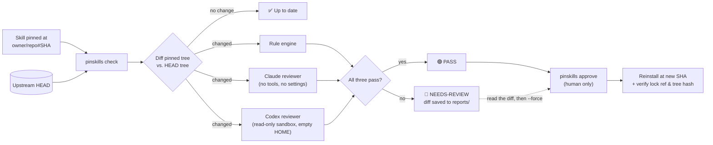

<div align="center">

# 📌 pinskills

**Pin your agent skills to commit SHAs. Let nothing change until two isolated LLM reviewers and a rule engine agree it's safe.**

[](https://www.npmjs.com/package/pinskills)
[](LICENSE)
[](https://nodejs.org/)
[](https://github.com/vercel-labs/skills)
[](#-the-review-pipeline)

English | [日本語](README.ja.md)

</div>

---

Agent skills are prompts with superpowers. A `SKILL.md` that your coding agent loads can tell it to read your SSH keys, `curl | sh` a script, or quietly hide things from you — and the agent will often comply.

`pinskills` turns third‑party skills into **reviewed, pinned dependencies**:

- 🔒 **Every skill is pinned to an exact commit SHA**, so `npx skills update` can't silently swap its contents.
- 🔍 **Every upstream change is diffed and reviewed** by static rules **and** two sandboxed LLM reviewers (Claude Code and Codex) that have no tools, no network, and no access to your config.
- ✅ **A pin only moves forward when you approve it**, and pinskills checks afterwards that the reviewed tree is the one that was installed.
- 📦 **The `skills` CLI itself is pinned and reviewed too**, along with all of its npm dependencies.

## Table of contents

- [Why](#-why)
- [How it works](#-how-it-works)
- [Requirements](#-requirements)
- [Installation](#-installation)
- [Quick start](#-quick-start)
- [Commands](#-commands)
- [Reading the results](#-reading-the-results)
- [The review pipeline](#-the-review-pipeline)
- [Adding new skills](#-adding-new-skills)
- [Pinning the `skills` CLI itself](#-pinning-the-skills-cli-itself)
- [Keep your agent from approving its own skills](#-keep-your-agent-from-approving-its-own-skills)
- [Files and configuration](#-files-and-configuration)
- [Limitations](#%EF%B8%8F-limitations)
- [License](#-license)

## 🤔 Why

[`npx skills`](https://github.com/vercel-labs/skills) installs agent skills into `~/.agents/skills` and shares them with Claude Code, Codex, GitHub Copilot and other agents. On the first `add` it shows third‑party audit results from skills.sh (Gen Agent Trust Hub, Socket, Snyk). But:

| | `npx skills` | with `pinskills` |
| --- | --- | --- |
| Audit on first install | Shown, but a **Critical** rating doesn't block the install | Full baseline review with `check --baseline` |
| Audit on `update` | **None.** Upstream changes are pulled in as‑is | Every change is diffed and reviewed before it can land |
| What decides the installed content | Whatever upstream `HEAD` is right now | A commit SHA that only you can move |
| The `skills` CLI and its deps | Latest version on every `npx -y` run, deps resolved by semver range | Locked with integrity hashes, and reviewed like a skill |

pinskills doesn't try to win on detection accuracy. It works by **change control**: once you pin a skill, its contents can only change through an explicit `approve` of a reviewed SHA.

## 🧭 How it works



1. **Pin.** A skill installed as `npx skills add owner/repo#<SHA>` records the SHA as its `ref` in `~/.agents/.skill-lock.json`. `npx skills update` compares only against that ref, so it never moves.
2. **Check.** For each skill, pinskills resolves upstream `HEAD` to a SHA once, then diffs the skill folder between the pinned tree and the `HEAD` tree.
3. **Review.** The diff goes through the rule engine and both LLM reviewers. A change is **PASS** only if every layer passes.
4. **Approve.** You move the pin forward. pinskills reinstalls that exact SHA, then checks that the lock's `ref` and folder hash match what was reviewed.

## 📋 Requirements

- **Node.js 22+**
- **git**
- **[Claude Code](https://docs.anthropic.com/en/docs/claude-code)** (`claude`), logged in
- **[Codex CLI](https://github.com/openai/codex)** (`codex`), logged in
- macOS or Linux

> [!NOTE]
> The terminal output is currently in Japanese. The commands, flags, exit codes and report files work the same in any locale.

## 📦 Installation

```sh
npm install -g pinskills
```

Install it globally rather than running it through `npx`. A guard that fetches its latest version on every run would be open to the same kind of silent change it exists to stop. To upgrade, read the release diff and then run `npm install -g pinskills@<version>`.

Starting with 0.1.1, releases are published from [GitHub Actions](.github/workflows/release.yml) via npm trusted publishing, so each of those versions carries a [provenance attestation](https://docs.npmjs.com/generating-provenance-statements) linking it to the exact commit and workflow run that built it. You can verify it with `npm audit signatures`.

Or clone it to hack on it:

```sh
git clone https://github.com/matzkoh/pinskills.git
cd pinskills
pnpm install
npm link
```

## 🚀 Quick start

**1. Pin what you already have.** Skills that aren't pinned yet are pinned to the commit that matches their current contents. Nothing is downloaded or changed. If the `skills` CLI isn't pinned yet, pinskills first pins the version `npx skills` would fetch today, dependencies included.

```sh
pinskills pin-current
```

**2. Review the current contents once.** This reviews each pinned skill as a full diff from an empty tree.

```sh
pinskills check --baseline
```

**3. Check for updates regularly.**

```sh
pinskills check
```

If you run `pinskills` with no arguments in a terminal, it asks whether to run `check` (default: **Yes**, so just press Enter).

Up to 4 skills are reviewed in parallel, with one live‑updating line per skill (translated from the Japanese UI):

```text
◇  Fetched upstream: 12 repositories, 3 with updates / 9 up to date
│
◆  Reviewing 1/3  ━━━━━━━━━━━━━━━━━━━━
│  ✓ frontend-design  PASS
│  ● pdf              claude 2/3  codex ✓
│  ○ xlsx             waiting
```

**4. Approve what passed.** When the check finishes, pinskills offers to act on the results right away (default: **No**, so Enter changes nothing):

1. *Pin N unpinned items to their current contents?*
2. *Update N items that PASSed?*
3. *Remove N skills that disappeared upstream?*

**5. Add new skills with `pinskills add`.** It takes the same sources as `npx skills add`. Leave out `--skill` to pick from the skills it finds. pinskills reviews the entire contents and, if they PASS, asks whether to install them pinned to the SHA (default: **No**).

```sh
pinskills add owner/repo --skill my-skill
```

## 🛠 Commands

| Command | What it does |
| --- | --- |
| `pinskills` | In a terminal: asks whether to run `check`. |
| `pinskills check [skill...]` | Diffs each pinned skill (and `skills-cli`) against upstream `HEAD` and reviews the changes. |
| `pinskills check --baseline [skill...]` | Reviews the **entire current contents** instead of the update. Doesn't record approvals. |
| `pinskills add <source> [--skill <name>...] [--full-depth]` | Reviews the **entire contents** of new skills and installs them pinned to a SHA. Sources and options mean the same as in `skills add`. |
| `pinskills approve <skill...>` | Moves the pin to the SHA reviewed by the last `check` or `add`. Allowed only for **PASS** results. |
| `pinskills approve <skill...> --force` | Moves the pin for a **NEEDS-REVIEW** result after you have read the diff yourself. |
| `pinskills pin-current [skill...]` | Pins unpinned skills (and the `skills` CLI) to what's currently installed. Contents don't change. |
| `pinskills remove <skill...>` | Removes skills with the pinned `skills` CLI and checks that they're gone from the lock. |

**Exit codes:** `check` and `add` exit `0` only if everything is PASS or up to date. It exits `1` if anything still needs attention or an error occurs, and `2` for an unknown command.

> [!IMPORTANT]
> The interactive prompts appear **only when a human is at the terminal**: stdin and stdout are both TTYs and the process isn't running under Claude Code (`CLAUDECODE` unset). Anywhere else, pinskills just prints the `approve` / `remove` / `pin-current` commands to run, and spinners fall back to plain, escape‑free lines.

## 🚦 Reading the results

| Status | Color | Meaning |
| --- | --- | --- |
| **Up to date** | 🟢 | Upstream hasn't changed the skill folder. Collapsed into a single line. |
| **PASS** | 🟢 | Changed upstream, and every review layer passed. Shows a summary of the change. |
| **NEEDS-REVIEW** | 🔴 | A rule fired, or a reviewer didn't return `pass`. Shows the rules hit, each reviewer's verdict and findings, and the path to the diff. |
| **Not comparable** | 🟡 | The pinned commit no longer exists upstream (e.g. history rewritten by a force-push). |
| **Folder missing** | 🟡 | The skill folder is gone from upstream `HEAD` (deleted or moved). Your pinned copy still works, and you can `remove` it. |
| **Unpinned / not covered** | 🟡 | Not SHA‑pinned, or not installed from GitHub. `update` can still change it. |

## 🔬 The review pipeline

Every diff passes through three independent layers. **All three must pass.**

### 1. Rule engine

Fast, deterministic checks on added lines:

| Rule | Catches |
| --- | --- |
| `invisible-unicode` | Zero‑width characters, bidi controls, BOM, soft hyphens, Unicode tag characters |
| `pipe-to-shell` | `curl … \| sh`, `wget … \| bash`, … |
| `long-base64` | Long encoded blobs (160+ chars) |
| `secret-path` | `~/.ssh`, `id_rsa`, `.aws/credentials`, `.netrc`, `.npmrc`, `gh auth token`, keychain reads |
| `injection-phrase` | "ignore previous instructions", "without telling the user", … (English and Japanese) |
| `dangerous-cmd` | `rm -rf ~`, `base64 -d`, `/dev/tcp/`, `nc -e`, `chmod +s`, `eval $(…)` |
| `exfil-endpoint` | webhook.site, requestbin, ngrok, pastebin, transfer.sh, Discord webhooks |
| `binary-file` | Binary files, whose contents reviewers can't read |
| `symlink-or-mode-change` | Symlinks and mode changes on existing files, which don't show up in the diff body |

### 2. Claude reviewer

Started with `claude -p --setting-sources "" --tools "" --strict-mcp-config --no-session-persistence`, in an empty temp directory with a minimal environment. It **loads none of your** CLAUDE.md, skills, plugins, MCP servers or hooks, and it has **zero tools**.

### 3. Codex reviewer

Started with `codex exec --sandbox read-only --ephemeral`, with an **empty `HOME`** that holds only a symlink to `auth.json`. Connected apps, plugins and web search belong to the account rather than to `HOME`, so they're disabled with explicit flags (`--disable apps --disable plugins -c web_search="disabled"`).

### Fail‑closed by design

- A reviewer that gets fooled **still can't exfiltrate data or modify files**.
- Requiring **both** reviewers to say `pass` makes it harder for one injected diff to slip through.
- A **timeout, crash, non‑JSON output or schema mismatch** counts as a failure, not a pass.
- Both reviewers return structured output (`verdict`, `summary`, `findings`) validated against a JSON schema.
- The untrusted diff is wrapped in a **random per‑call delimiter**, and reviewers are told to treat everything inside it as data.
- Large diffs are split by file (huge files by line) into ~250 KB batches. **If any batch fails, the whole skill fails.** Diffs over 6 MB go straight to a human.
- **Diff bodies are written to `reports/`, never to stdout.** If an agent runs pinskills, the untrusted text doesn't enter its context. Anything echoed from reviewers or upstream is stripped of ANSI escapes, control characters and invisible Unicode first.

## ➕ Adding new skills

`pinskills add` leaves it to `skills` to decide which skills to fetch and from where, and adds only the review and the pin:

1. Runs `skills add <source> -g -y` with the pinned `skills` CLI against a throwaway `HOME`. Nothing is written to your real `~/.agents` or agent config directories.
2. If you didn't pass `--skill` and the source has more than one skill, asks which ones to review before reviewing anything, since each review calls the LLMs. Where it can't prompt, it lists the skills it found and how to pick them with `--skill`, then exits without reviewing.
3. Reads the name, source and folder hash of each skill from that throwaway lock, and finds the upstream commit SHA whose tree matches the hash.
4. Reviews the diff from an empty tree to those contents with the same three layers as `check`, and records the result for `approve`.
5. Installs what PASSed after you confirm in the terminal, the same way `approve` does (installs `source#SHA`, then checks the lock's `ref` and folder hash). For NEEDS-REVIEW results, read the diff and use `approve --force`.

Skills that are already installed are skipped. Use `check` to review their updates.

## 📦 Pinning the `skills` CLI itself

A pinned SHA doesn't help if the installer is compromised. `npx -y skills` fetches the latest release every time and resolves its dependencies (`tar`, `yaml`, …) by semver range, so a hijacked package could install something other than the SHA you reviewed.

So pinskills never calls `npx skills`. It runs its own pinned copy, which appears in `check` as **`skills-cli`**:

- The CLI is pinned with a `package-lock.json` (exact versions **and** integrity hashes for every dependency) in `~/.local/share/pinskills/cli/`.
- On `check`, pinskills resolves a fresh lock for the latest `skills` and compares it with the pinned lock. **A dependency-only change counts as an update.**
- Every package in both locks is downloaded from the npm registry, **integrity‑verified**, extracted and committed as a git tree, then diffed and reviewed like a skill. Reviewers get CLI‑specific guidance: installing content other than what was requested, sending secrets out, suspicious dependencies, and so on.
- Source maps and type declarations (`*.map`, `*.d.ts`, …) are skipped because they never execute. Bundled `.gz` files are decompressed and reviewed as text.
- `approve skills-cli` runs `npm ci --ignore-scripts` into a staging directory and swaps it in only after that succeeds, so a failed install never breaks the pinned CLI.
- The CLI always runs with `DISABLE_TELEMETRY=1` and `DO_NOT_TRACK=1`. By default, `skills` reports the source of each skill you install or remove (private repository names included) to skills.sh.

## 🛡 Keep your agent from approving its own skills

`approve` is meant for humans. In Claude Code, add these to `permissions.deny` in `~/.claude/settings.json` so the agent can't install skills or move pins on its own:

```json
"Bash(*skills add *)",
"Bash(*skills a *)",
"Bash(*skills install *)",
"Bash(*skills i *)",
"Bash(*skills experimental_install*)",
"Bash(*skills use *)",
"Bash(*skills sync*)",
"Bash(*skills@* add *)",
"Bash(*skills@* a *)",
"Bash(*skills@* install *)",
"Bash(*skills@* i *)",
"Bash(*pinskills* approve*)",
"Bash(*pinskills* pin-current*)"
```

`Bash(*skills add *)` also matches `pinskills add`, so the agent can't run `pinskills add` either.

To add or approve skills from inside a Claude Code session, run the command yourself with the `!` prefix, e.g. `! pinskills approve my-skill`.

> [!WARNING]
> These rules only bind Claude Code. Other agents that share `~/.agents/skills` (Codex, GitHub Copilot, …) can still run `npx skills add` on their own.

## 📁 Files and configuration

| Purpose | Location |
| --- | --- |
| Review records (`state.json`) and reports | `~/.local/state/pinskills/` (honors `XDG_STATE_HOME`) |
| Pinned `skills` CLI | `~/.local/share/pinskills/cli/` (honors `XDG_DATA_HOME`) |
| Upstream repository cache | `~/.cache/pinskills/` (honors `XDG_CACHE_HOME`, safe to delete) |
| What pinskills protects | `~/.agents/skills/` and `~/.agents/.skill-lock.json` |

Review records live **outside** `~/.agents` on purpose, away from a directory that Codex and Copilot also write to.

Each `check` writes a timestamped report directory with a `report.json` and one `<skill>.diff` per reviewed skill.

> [!CAUTION]
> The `.diff` files in `reports/` contain **untrusted upstream content verbatim**. Be careful when you let an agent read them.

For testing, these environment variables override the locations:

| Variable | Overrides |
| --- | --- |
| `PINSKILLS_AGENTS_DIR` | Where to find `.skill-lock.json` (default `~/.agents`) |
| `PINSKILLS_STATE_DIR` | Review records and reports |
| `PINSKILLS_DATA_DIR` | The pinned `skills` CLI |

## ⚠️ Limitations

pinskills **won't reliably detect** every dangerous change. Prompt injection can be written in plain prose, and both the rules and the LLM reviewers can miss it. What it **does** guarantee is narrower:

> **No change reaches your agents without going through `approve`.**

- A diff crafted to fool **both** reviewers at once can only be caught by the human doing the final approval.
- The Codex reviewer can't write or reach the network, but it **can read local files**.
- Reviewers judge the diff. They don't run an agent with the skill loaded to see how it behaves.
- Only skills installed from **GitHub** with a folder hash in the lock can be reviewed. Everything else is reported as *not covered* and fails the check.

## 📄 License

[MIT](LICENSE) © matzkoh
